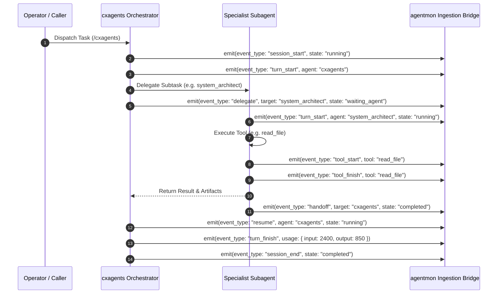

# Agent Systems Specification: Global Agent Monitor (`agentmon`)

**Author:** Staff Agent Systems Architect & Meta-Agent Engineer (`agent_architect`)  
**Context:** CortexOps Multi-Agent Framework (`cxagents`)  
**Target:** Client Detection, Hook Integration Contracts, and Framework Lifecycle  
**Date:** 24 November 2026  

---

## 1. Multi-Surface Client Detection & Capabilities

The Global Agent Monitor automatically detects installed agent platforms across the host workstation:

| Surface Identifier | Target Application | Platform Detection Path (Linux / macOS) | Platform Detection Path (Windows) | Capability Profile |
| :--- | :--- | :--- | :--- | :--- |
| `antigravity-app` | Google Antigravity Desktop | `~/.gemini/antigravity/` or `/opt/Antigravity` | `%LOCALAPPDATA%\Programs\Antigravity` | Lifecycle hooks, multi-agent turns, status feeds. |
| `antigravity-cli` | `agy` Command Line Tool | `~/.gemini/bin/agy` or `which agy` | `%USERPROFILE%\.gemini\bin\agy.cmd` | Turn usage, status line updates, tool events. |
| `antigravity-vsc` | Antigravity VS Code Extension | `~/.vscode/extensions/google.antigravity*` | `%USERPROFILE%\.vscode\extensions\google.antigravity*` | Extension panel conversations, multi-window events. |
| `codex-cli` | OpenAI Codex CLI | `which codex` or `~/.codex/` | `%APPDATA%\Codex` | CLI executions, thread turns, prompt requests. |
| `codex-vsc` | OpenAI Codex Extension | `~/.vscode/extensions/openai.codex*` | `%USERPROFILE%\.vscode\extensions\openai.codex*` | IDE workspace jobs, background test runs. |
| `claude-cli` | Anthropic Claude Code CLI | `which claude` or `~/.claude/` | `%APPDATA%\Claude` | Subagent forks, tool dispatches, result totals. |
| `claude-vsc` | Claude Code Extension | `~/.vscode/extensions/anthropic.claude*` | `%USERPROFILE%\.vscode\extensions\anthropic.claude*` | Extension task turns, approval requests. |
| `cortexops-core` | CortexOps Multi-Agent Engine | Global `@ctxthuta/cxops` / local repo | Global npm / local repo | Deep skill delegation, 37 specialist roles, handoffs. |

---

## 2. Universal Hook Adapter Contract

Every adapter emits normalized events conforming to the canonical envelope. In standard execution, events are transmitted to the collector socket; if the socket is unreachable, events append to the local spool file:

```javascript
/**
 * Emits an event to the Global Agent Monitor.
 * Safe for fire-and-forget execution with zero overhead (< 15 ms).
 */
function emitAgentmonEvent(event) {
    const payload = JSON.stringify(event);
    const sockPath = getSocketPath();

    // 1. Try sending to active collector socket
    const client = net.createConnection({ path: sockPath }, () => {
        const lenBuf = Buffer.alloc(4);
        lenBuf.writeUInt32BE(Buffer.byteLength(payload), 0);
        client.write(Buffer.concat([lenBuf, Buffer.from(payload, 'utf-8')]));
        client.end();
    });

    client.on('error', () => {
        // 2. Fallback to local disk spool on connection refusal
        appendSpool(payload);
    });
}
```

---

## 3. CortexOps Framework Lifecycle Mapping

The CortexOps orchestrator dispatches lifecycle events mapped to framework execution phases:



---

## 4. Diagnostic & Capability Reporting (`agentmon doctor`)

The `agentmon doctor` command queries installed client surfaces and outputs a structured health summary:
- **Client Version:** Current binary / extension version string.
- **Hook Status:** `Enrolled` / `Not Enrolled`.
- **Connection Health:** `Healthy` / `Degraded` / `Offline`.
- **Capability Score:** `Verified` (full lifecycle & usage), `Partial` (lifecycle only, tokens unreported), or `Unsupported`.
- **Last Observed Event:** Timestamp of latest telemetry record.
