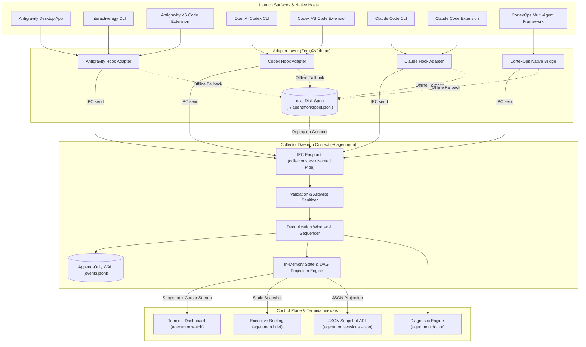
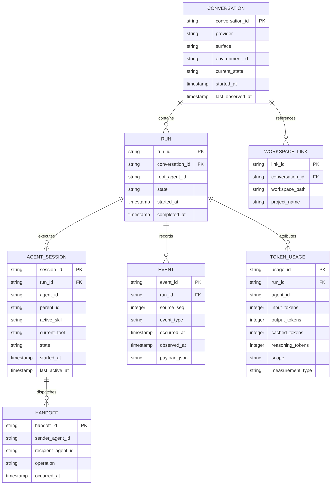
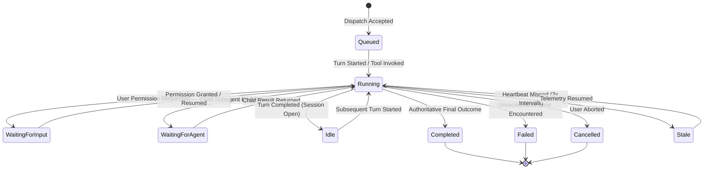

# System Architecture: Global Agent Monitor (`agentmon`)

**Author:** Principal Systems Architect (`system_architect`)  
**Context:** CortexOps Multi-Agent Framework (`cxagents`)  
**Specification Reference:** `Global_Agent_Monitor_BRD.docx` & `Global_Agent_Monitor_FRD.docx`  
**Date:** 24 November 2026  

---

## 1. System Topology & Bounded Contexts

The Global Agent Monitor (`agentmon`) is decomposed into four decoupled bounded contexts:
1. **Telemetry Adapters & Spooling Context:** Captures native lifecycle events from Antigravity, Codex, Claude Code, and CortexOps with sub-millisecond hook overhead and bounded local disk spooling.
2. **Collector Daemon & Ingestion Context:** User-scoped single-writer daemon managing IPC socket communication, allowlist validation, event deduplication, and atomic journal commits.
3. **Projection & State Engine Context:** Maintains in-memory DAG topologies, out-of-order parent-child resolution, normalized token accounting, and active conversation state.
4. **Terminal Interface & CLI Context:** Real-time terminal dashboard (`agentmon watch`), headless JSON streams (`agentmon sessions`), executive briefings (`agentmon brief`), and diagnostics (`agentmon doctor`).



---

## 2. Ingestion Event Envelope (v1 Schema)

Every event emitted across native adapters and framework dispatches adheres to a strict canonical JSON schema.

### 2.1 JSON Schema Specification

```json
{
  "$schema": "https://json-schema.org/draft/2020-12/schema",
  "title": "AgentmonEventEnvelopeV1",
  "type": "object",
  "required": [
    "schema_version",
    "event_id",
    "source_id",
    "occurred_at",
    "provider",
    "surface",
    "environment_id",
    "profile_id",
    "conversation_id",
    "run_id",
    "agent_id",
    "event_type",
    "state"
  ],
  "properties": {
    "schema_version": { "type": "integer", "const": 1 },
    "event_id": { "type": "string", "minLength": 1 },
    "source_id": { "type": "string", "minLength": 1 },
    "occurred_at": { "type": "string", "format": "date-time" },
    "source_seq": { "type": "integer", "minimum": 0 },
    "provider": { "type": "string", "enum": ["antigravity", "codex", "claude", "cortexops", "unknown"] },
    "surface": { "type": "string", "enum": ["app", "cli", "vscode", "headless", "unknown"] },
    "environment_id": { "type": "string" },
    "profile_id": { "type": "string" },
    "conversation_id": { "type": "string", "minLength": 1 },
    "run_id": { "type": "string", "minLength": 1 },
    "agent_id": { "type": "string", "minLength": 1 },
    "parent_id": { "type": ["string", "null"] },
    "project_ids": { "type": "array", "items": { "type": "string" }, "default": [] },
    "skill_id": { "type": ["string", "null"] },
    "tool_name": { "type": ["string", "null"] },
    "target_agent_id": { "type": ["string", "null"] },
    "event_type": {
      "type": "string",
      "enum": [
        "session_start",
        "turn_start",
        "tool_start",
        "tool_finish",
        "delegate",
        "handoff",
        "wait_input",
        "wait_agent",
        "resume",
        "turn_finish",
        "session_end",
        "usage_report",
        "heartbeat",
        "error"
      ]
    },
    "state": {
      "type": "string",
      "enum": [
        "queued",
        "running",
        "waiting_input",
        "waiting_agent",
        "idle",
        "completed",
        "failed",
        "cancelled",
        "stale"
      ]
    },
    "activity_summary": { "type": "string", "maxLength": 256 },
    "usage": {
      "type": "object",
      "properties": {
        "input_tokens": { "type": "integer", "minimum": 0 },
        "output_tokens": { "type": "integer", "minimum": 0 },
        "cache_read_tokens": { "type": "integer", "minimum": 0 },
        "cache_write_tokens": { "type": "integer", "minimum": 0 },
        "reasoning_tokens": { "type": "integer", "minimum": 0 },
        "scope": { "type": "string", "enum": ["agent", "turn", "conversation", "model"] },
        "measurement_type": { "type": "string", "enum": ["delta", "snapshot", "aggregate"] }
      }
    },
    "evidence": { "type": "string", "enum": ["provider_reported", "framework_reported", "inferred"] }
  },
  "additionalProperties": false
}
```

---

## 3. Data Model & Entity Relationships

The data engine projects raw telemetry into an optimized relational model for fast querying and low-memory state maintenance.



---

## 4. State Transitions & Lifecycle Machine

Agent sessions and runs follow deterministic finite state transitions.



---

## 5. Storage Engine & WAL Specification

### 5.1 Storage Architecture
The storage engine uses an append-only Write-Ahead Log (WAL) pattern:
- **Location:** `~/.agentmon/events.jsonl` (mode `0600`).
- **Index File:** In-memory B-Tree / Map indexed by `conversation_id`, `run_id`, `agent_id`, and `event_id`.
- **Checkpointing:** On graceful shutdown or every 10,000 events, the daemon generates a compacted state snapshot `~/.agentmon/snapshot.json`.
- **Replay & Crash Recovery:** On startup, the daemon loads `snapshot.json` (if present) and replays uncompacted WAL lines to reconstruct the complete state projection in $< 1.5$ seconds for 10,000 events.

### 5.2 Purge Semantics
When an operator issues `agentmon history --purge <project>`:
1. All conversation IDs mapped to `<project>` are marked tombstoned.
2. In-memory projections remove the matching entries immediately.
3. The WAL is rewritten atomically (`events.jsonl.tmp` -> `events.jsonl`) omitting all events matching the purged project.
4. Active viewers receive a purge synchronization message to clear local rows.

---

## 6. IPC Protocol & Framing

The IPC interface uses length-prefixed stream framing over Unix Domain Sockets (`collector.sock`) or Windows Named Pipes (`\\.\pipe\agentmon-collector`).

### 6.1 Framing Specification
```
+-------------------+-----------------------------------------------+
|  Length (4 Bytes) |           Payload (JSON UTF-8)                |
|  Big-Endian UInt  |           Max Size: 65,536 Bytes              |
+-------------------+-----------------------------------------------+
```

### 6.2 IPC Message Types
1. `INGEST_EVENT`: Client adapter pushes an event envelope to the collector.
2. `ACK`: Collector returns confirmation with assigned global sequence number.
3. `SUBSCRIBE`: Viewer subscribes to state stream starting from a specified `cursor` (or `0` for full snapshot).
4. `SNAPSHOT`: Collector transmits full in-memory projection to a newly connected viewer.
5. `EVENT_DIFF`: Collector broadcasts a verified event diff to all active viewers.
6. `PING` / `PONG`: Heartbeat keepalive every 10 seconds.

---

## 7. Performance & Resilience Guarantees

1. **Sub-Millisecond Ingestion:** Ingestion, validation, and in-memory projection complete in $< 0.4$ ms per event.
2. **Deterministic Deduplication:** Sliding 10,000-event hash set prevents duplicate ingestion from network or hook retries.
3. **Bounded Memory:** Memory footprint is strictly bounded to $< 50$ MiB RSS for 100 concurrent agents and 10,000 retained events.
4. **Zero Impact on Native Tools:** When the collector daemon is offline or non-responsive, native adapters complete execution in $< 15$ ms by appending to `spool.jsonl`, never blocking the user's IDE or CLI workflow.
