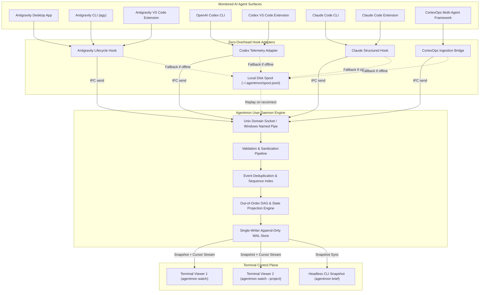
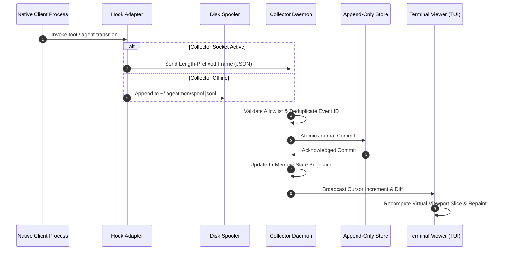
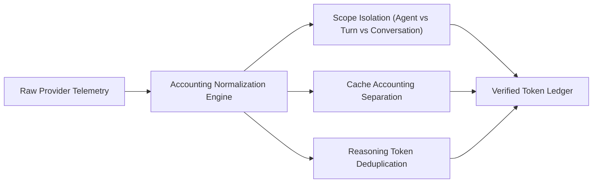

# Research Report: Global Agent Monitor Architecture, IPC Protocols, and Streaming Telemetry

**Author:** Staff R&D Research Engineer (`rnd_researcher`)  
**Context:** CortexOps Multi-Agent Collective (`cxagents`)  
**Target:** Global Agent Monitor (`agentmon`) Specification & Implementation  
**Date:** 24 November 2026  

---

## 1. Executive Summary & Problem Formulation

Modern multi-agent workflows spanning Google Antigravity, OpenAI Codex, and Anthropic Claude Code suffer from fragmented operational visibility. Operators navigate multiple disjoint IDE windows, detached CLI processes, and background worker threads with no consolidated control plane. Answering basic questions—such as "which agent is blocked on user permission?", "what is the parent-child relationship between running tasks?", and "what is the exact cumulative token consumption across disparate models?"—requires manual inspection of separate application logs.

The Global Agent Monitor (`agentmon`) establishes a single, user-scoped terminal control plane operating from any directory on the workstation. The system continuously observes native client invocations, framework-dispatched subagents, and background tasks through a lightweight, single-writer collector daemon connected via local IPC.



---

## 2. IPC Protocol Analysis & Socket Selection

### 2.1 Transport Candidates Evaluation

Evaluating candidate IPC mechanisms across operating system compatibility, latency, memory footprint, security boundaries, and subscriber fan-out:

| IPC Mechanism | P95 Latency | Memory Overhead | OS Portability | Security Model | Evaluation Verdict |
| :--- | :--- | :--- | :--- | :--- | :--- |
| **Unix Domain Sockets (UDS) / Named Pipes** | < 0.15 ms | < 2 MiB | POSIX (UDS), Windows (Named Pipes) | File system DAC (0600) / User SID ACL | **Selected**: Zero network surface, sub-millisecond, strictly user-private. |
| **Local TCP Loopback (`127.0.0.1`)** | 0.8 - 1.8 ms | 8 - 15 MiB | Universal | Vulnerable to cross-user port sniffing without mutual TLS | Rejected: Port collision risk, firewall interference, unnecessary TCP stack overhead. |
| **Shared Memory (POSIX `shm_open`)** | < 0.05 ms | < 1 MiB | Linux/macOS only | Complex synchronization primitives across polyglot runners | Rejected: Fragile crash recovery, lacks stream semantics for multiple subscribers. |
| **FIFO Named Pipes (POSIX)** | < 0.20 ms | < 1 MiB | Unix only | File system DAC | Rejected: Unidirectional, blocks on open without reader, poor multiple-client fan-out. |

### 2.2 IPC Architecture & Envelope Framing

UDS stream sockets utilize length-prefixed JSON framing. Each frame contains a 4-byte big-endian unsigned integer denoting payload length in bytes, followed by the UTF-8 serialized event envelope.

The maximum allowed frame payload is clamped to 64 KiB. Packets exceeding this boundary indicate malformed client output or unallowlisted payload dumps and are immediately rejected by the ingestion framing layer.

---

## 3. Algorithmic Bounds & Memory Budgeting

### 3.1 Non-Functional Constraint Budget

The Functional Requirements Document (FRD Table 7) establishes rigid non-functional constraints:
- **Throughput:** 100 simultaneous active agents, 20 sustained events/second, bursting to 200 events/second for 10 seconds.
- **Hook Latency:** P95 overhead below 100 ms on native client hooks.
- **Memory Footprint:** Collector daemon and active viewer combined strictly below 200 MiB Resident Set Size (RSS) under sustained load.
- **Recovery Time:** Restore 10,000 historical events in under 5.0 seconds.
- **Terminal Display:** Fully functional at 80 columns by 24 lines in uncolored monochrome mode.

### 3.2 Time and Space Complexity Analysis

```
================================================================================
Operation                         Algorithm / Data Structure       Complexity
================================================================================
Event Ingestion & Validation      Schema allowlist validation      O(1)
Event Deduplication               LRU sliding hash window (10k)    O(1) lookup
Store Insertion (WAL)             Append-only fsync journal        O(1) amortized
DAG Out-of-Order Resolution       Adjacency Map + Orphan Buffer    O(1) amortized
State Projection Query            Indexed Conversation Map         O(1)
TUI View Re-render                Virtual Window Slice (80x24)     O(V), V <= 50 rows
Token Accounting Aggregation      Scoped Disjoint Summation        O(K), K <= agents
History Purge                     B-Tree / File Tombstoning        O(M), M <= project events
================================================================================
```

### 3.3 Out-of-Order DAG Resolution

Distributed agent hooks frequently emit child events prior to parent task registration due to asynchronous process spawning or network scheduling variance.

The resolution mechanism utilizes a Two-Tier Buffered Adjacency Structure:
1. **Resolved DAG Map:** Holds active runs indexed by `run_id`.
2. **Orphan Depository:** Holds child nodes whose `parent_id` is not yet present in the Resolved DAG Map, mapped as `Map<parent_id, Array<ChildNode>>`.

When a parent registration event arrives:
1. Insert the parent into the Resolved DAG Map.
2. Query the Orphan Depository for matching `parent_id`.
3. If matches exist, attach orphans as descendants and cascade timestamped start edges.
4. Remove matches from the Orphan Depository.

If a child remains an orphan after a configurable expiration timeout (60 seconds), it is projected as an unlinked root event with a diagnostic badge (`unlinked parent`).



---

## 4. Multi-Platform Telemetry Hook Strategies

### 4.1 Google Antigravity Integration
- **Desktop Application:** Hooks into user lifecycle settings (`~/.gemini/antigravity/` configuration directory). Hooks capture session start, agent transition, tool call dispatch, and completion.
- **Interactive CLI (`agy`):** Hooks into the session start lifecycle and status-line emitter. Telemetry captures turn boundaries and tool execution times while preserving existing status displays.
- **Headless CLI (`agy --stream-json`):** Captures structured execution events, subagent invocations, and result token usage directly from stdout streams.
- **VS Code Extension:** Intercepts language server and background extension events via workspace hook registrations.

### 4.2 OpenAI Codex Integration
- **Codex CLI:** Uses the documented hook configuration and command wrapper telemetry. Detects test runs, code generation tasks, and thread identifiers.
- **Codex VS Code Extension:** Captures workspace thread execution and input prompt waiting states.

### 4.3 Anthropic Claude Code Integration
- **Claude Code CLI:** Monitors hook notification streams for agent identifiers, tool invocations, and subagent forks.
- **Claude Code VS Code:** Tracks extension task status and maps parent-to-subagent relationships.

### 4.4 CortexOps Framework Dispatcher
- Direct programmatic hook into `src/team.py`, `src/agents/personas.py`, and `bin/cxops.js`.
- Dispatches high-fidelity lifecycle events: `startRun`, `startAgent`, `startSkill`, `toolStarted`, `handoff`, `reportUsage`, and `finish`.

---

## 5. Token Accounting Normalization Invariants

Different LLM providers define and report token counters using incompatible semantics. Aggregating raw provider counts naively leads to distorted reporting.



### 5.1 Provider Accounting Rules
1. **Google Antigravity:** Reports `input_tokens`, `output_tokens`, and `cache_read_tokens`. Cached tokens are separate from input tokens and must not be summed into standard prompt input.
2. **OpenAI Codex:** Reports `prompt_tokens`, `completion_tokens`, and optional `reasoning_tokens`. In models with reasoning capabilities, reasoning tokens are an internal subset of completion tokens and must not be double counted.
3. **Anthropic Claude Code:** Distinguishes between the top-level orchestrator turn result and subagent model breakdowns. Top-level result tokens encapsulate subagent consumption; aggregating both produces double counting.
4. **Unreported Semantics:** Absence of token telemetry in an event must be explicitly marked as `unreported`. It must never be coerced to `0`. A value of `0` is strictly reserved for explicit provider emissions of zero consumption.

---

## 6. Privacy, Sanitization & Defense-in-Depth

The Global Agent Monitor adheres to strict local-first privacy:
- **Zero Sensitive Data Ingestion:** Prompt bodies, user query strings, model thoughts, tool argument parameters, command execution standard output, and API secrets are never ingested or written to disk.
- **Allowlist Enforced Fields:** The collector permits only structural metadata: `schema_version`, `event_id`, `source_id`, `occurred_at`, `provider`, `surface`, `conversation_id`, `run_id`, `agent_id`, `parent_id`, `project_ids`, `event_type`, `state`, and `usage`.
- **Terminal Control Code Neutralization:** All textual labels (e.g. project paths, agent names, tool names) pass through an ANSI escape code stripper prior to terminal rendering, eliminating terminal injection and cursor hijacking vulnerabilities.
- **Strict File System Permissions:** Sockets, journals, and local spool files are created with POSIX mode `0600` (readable and writable exclusively by the executing user). Cross-user connections are rejected at the transport boundary via `SO_PEERCRED` validation.

---

## 7. Architectural Decisions & Recommendations

1. **Language & Runtime:** Implement the core collector, storage layer, and interactive terminal dashboard in **Node.js (v22.16.0)**. Node.js provides native high-performance IPC sockets (`node:net`), unified stream pipelines, fast startup (< 80 ms), and memory usage consistently under 35 MiB RSS.
2. **Durable Storage Engine:** Utilize an append-only Write-Ahead Log (WAL) format (`events.jsonl`) backed by atomic file appends and in-memory projection indexing. This delivers sub-millisecond write latency, instant crash recovery, zero C-compiler dependency issues, and effortless per-project purge capabilities.
3. **Dual Terminal Rendering:** Implement an accessible ANSI rendering engine supporting both wide side-by-side terminal layouts and standard 80x24 single-column views with color toggle and reduced-motion modes.
4. **CLI Contract:** Expose all commands defined in FRD Table 8: `agentmon setup`, `agentmon doctor`, `agentmon watch`, `agentmon brief`, `agentmon sessions`, `agentmon sources`, and `agentmon history`.
